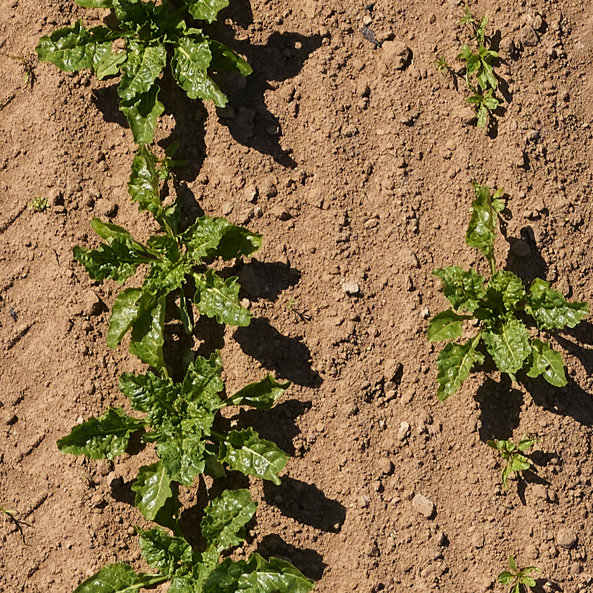
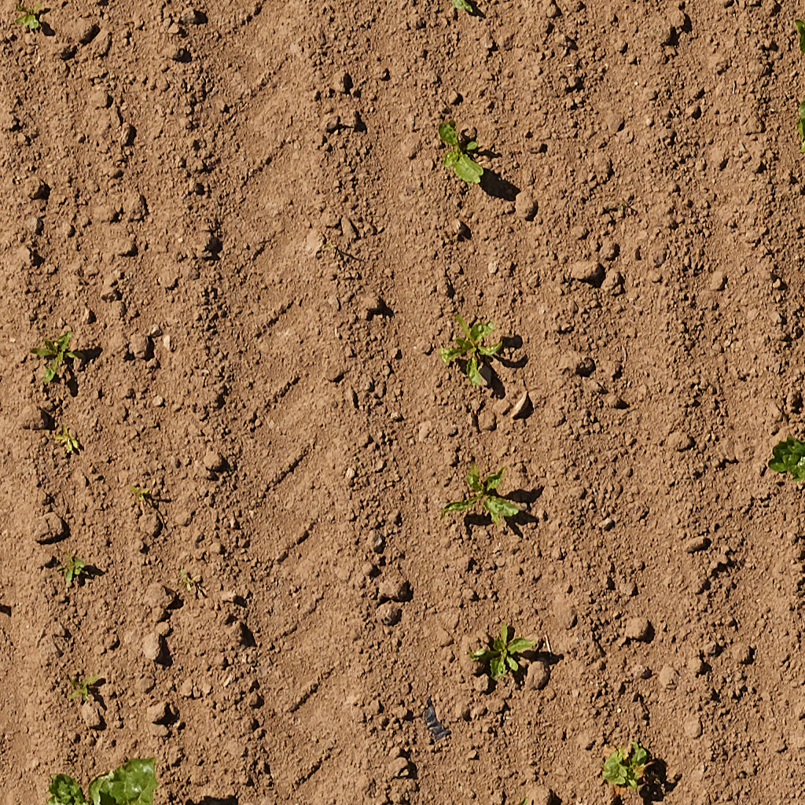
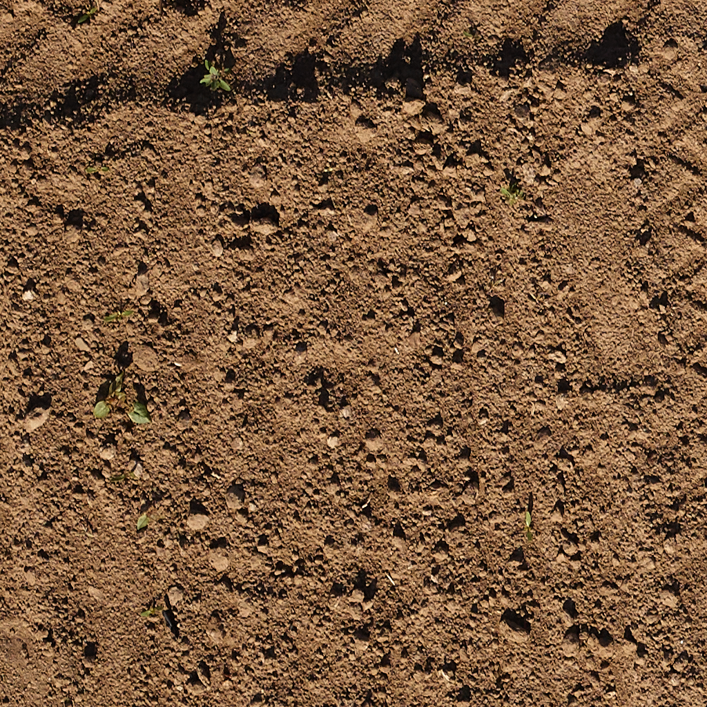

# Try ElderLeaf: three demo scenarios

Three short tests you can run yourself in a few minutes, each with a real field photo from this repository.

**Where:** the web app at **https://elderleaf.vercel.app** (no sign-up needed: you start as a guest), or the Android
app [`release/ElderLeaf.apk`](release/ElderLeaf.apk). Both use the same production API.

**Steps (the same for all three):**

1. Save the scenario photo below to your computer or phone (click it, then download).
2. In the app, create a **New plot** with the settings given for the scenario. Leave **Crops in the photo** on *One crop*.
3. After **Create and take a photo**, choose **From gallery** and pick the photo.
4. Set **Taken on** to the date given. The date matters: it sets the plants' age (for "Is this normal?") and the
   day of weather used for the water estimate.
5. Press **Analyze photo**. The agent's steps stream in live; an analysis takes about a minute (one Muse Spark call to
   choose search words, several SAM 3.1 calls, then the report agent).

Numbers can move a little between runs, because the agent chooses its search words again each time.

---

## Scenario 1: a sugar beet plot (count, crop cover, "Is this normal?", water)

| Plot setting | Value |
|---|---|
| Crop | Sugar beet |
| Planted on | 2026-09-25 |
| Area | 10 m² |
| Location | allow the browser's location, or enter latitude 39.89, longitude 32.78 |
| Taken on | 2026-11-04 (day 40) |

**You should see**

- About **6–12 plants**, each with its own mask (tap a plant on the photo to highlight it).
- **Crop cover about 22%**, **weed share about 4%**.
- **Is this normal?**: development stage, cover *within the typical 22–71%* for day 40, no warnings.
- **Water today**: about **0.5 L per m²**, about **5 L** for the 10 m² plot (FAO-56 with Open-Meteo's ET0 for that day).
- A short report written by Muse Spark in plain words. Every number in it was checked against the measurements.

## Scenario 2: a crowded row of seedlings (counting)

| Plot setting | Value |
|---|---|
| Crop | Sugar beet |
| Planted on | 2026-10-28 |
| Taken on | 2026-11-04 (day 7) |

**You should see**

- About **13 plants** (14 when counted by hand: two touching seedlings can merge into one mask).
- **Crop cover about 2.7%**, inside the *typical 2–12%* for day 7.
- Open **How this was measured** to see which search words the agent picked and, for each SAM 3.1 call, everything
  it returned.

## Scenario 3: a weedy bed

| Plot setting | Value |
|---|---|
| Crop | Sugar beet |
| Planted on | 2026-10-28 |
| Taken on | 2026-11-04 |

**You should see**

- **Weed share about 50%**, shown as magenta masks next to the green crop masks.
- A **Many weeds** badge and a next step about weeding ("a good time to weed").
- The seedlings are small for their age, so a **Behind typical** badge may appear too.

---

**Going further:** upload a second photo to the same plot with a later **Taken on** date, add a note in between
(for example *Observation: pulled the weeds*), then open **Compare** on the plot page: a difference table with
per-day rates, your notes, and a change summary written from both photos.

*Photos: PhenoBench validation split (Weyler et al., IEEE TPAMI 2024), CC BY-NC-SA 4.0, unmodified, used here for
non-commercial demonstration with attribution.*
