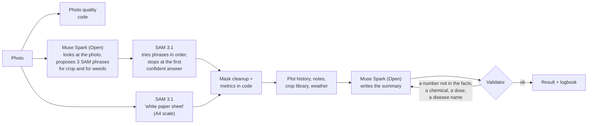

# ElderLeaf

**An old hand for every new grower.**

ElderLeaf measures and tracks a plot from a phone: it counts plants, measures crop cover and weed share from a photo, follows the same plot week by week, and explains in plain language what each number means. Every number is tied to a SAM 3.1 mask you can tap on screen. A Muse Spark agent explains the numbers but never produces one. A health check (possible signs, a confidence level, a "consult an agronomist" flag) comes on top, and it is deliberately cautious.

Built for the [Meta Global AI Developer Hackathon](https://dev.meta.ai/events/global-hackathon), track *Build for Your World*, for beginner growers such as community-garden volunteers, new urban gardeners and agriculture students.

---

## Why

An experienced grower looks at a bed and says "this row is behind." Someone who just started can't see that. They also can't tell whether 38% crop cover on day 34 is good or bad. ElderLeaf gives them the measurement, the history, and an answer to "is this normal, and what should I do this week?"

## What it does

| | |
|---|---|
| **Measure from a photo** | Plant count, crop cover %, weed share %, mean plant size (in cm² when an A4 sheet is in the frame), photo-quality check. Each number has a "How it's computed" line and links to its masks. |
| **"Is this normal?"** | Each number is compared with the crop's FAO-56 growth stage for its age (crop library), then labelled *Normal* or *Needs a look* with one sentence of context. |
| **Logbook** | Every photo and note (watering, fertilizer, spraying, observation) by date, trend charts, CSV export. |
| **Compare** | Two dates side by side with a slider (masks on), a difference table with per-day rates, the notes written in between, and a change summary. |
| **Water today** | FAO-56: today's reference evapotranspiration for the plot's location × the crop coefficient for its stage, scaled down by the crop cover we measured. In L/m² and for the whole plot. |
| **Cautious health check** | Possible signs only, with a confidence level and a "consult an agronomist" flag set by rules in code. ElderLeaf never gives a diagnosis, never names a chemical and never gives a dose. |
| **Demo workspace** | Plots that were analysed beforehand, open to anyone without signing in. Viewing them makes no API calls. |
| **Accounts (optional)** | Use it as a guest, or sign up with e-mail + password to keep your plots and open them on any device. A profile holds your name, garden (e.g. METU Bostan), growing experience and your totals. |

## How Meta's models are used



- **SAM 3.1** (Meta Model API) draws every mask: one request per concept (crop, weeds, A4 sheet, leaf spots).
- **Muse Spark Open** (`meta-models/muse-spark-open-1026` on Baseten, open weights) is the default reasoning model. One setting switches to Muse Spark 1.3 on the Meta Model API. It has two jobs:
  1. **Prompt agent** ([`agent.py`](api/elderleaf/agent.py)): it looks at the photo and proposes ranked SAM phrases (e.g. "lettuce seedling", "grass weed"). The pipeline tries them in order and falls back to fixed words when SAM is unsure. When the grower marks a bed as having **more than one crop**, it switches to **scan mode**: it lists one phrase per kind of plant it sees (as many as the photo needs), each marked with its crop or as a weed, SAM searches them all, and the app counts each crop separately.
  2. **Report agent** ([`report_agent.py`](api/elderleaf/report_agent.py)): it checks plant health in code (yellowing, browning and leaf spots inside the crop masks), may ask SAM 3.1 to **look closer** at a possible problem it sees in the photo, and turns the facts into 2–3 plain sentences, a line for each "Is this normal?" check and one thing to do this week, in the tone of the grower's experience (from their profile). It also writes the change summary of **Compare** from both photos. Everything is combined into one report (`GET /analyses/{id}/report.md`).
- **The validator** checks every sentence before a grower sees it. Each number must appear in the facts (measurements, history, crop library, weather), there must be no pesticide or chemical names and no doses, and no disease or pest names. A failed text goes back to the model with the reasons. If it fails again, the grower sees a summary built from templates. The UI shows what the validator caught.
- **No LLM output becomes a number.** Counts, percentages, sizes, water need and the consult flag are all computed in code ([`metrics.py`](api/elderleaf/metrics.py), [`irrigation.py`](api/elderleaf/irrigation.py), [`pipeline.py`](api/elderleaf/pipeline.py)).

Every step is written to the analysis trace as it happens, so the app shows the agent working live (`propose_prompts` or `scan_plants → run_sam → compute_metrics → get_plot_history → lookup_crop_info → get_weather → assess_health → write_summary → (run_sam to look closer) → validate`), with a link to everything each SAM call returned.

## Evaluation

SAM 3.1 against hand-labelled masks of **PhenoBench** (val split, 772 images, sugar beet + weeds, three growth stages). Full tables are in [`eval/results/full/`](eval/results/full/summary.md); the method is in [`eval/README.md`](eval/README.md).

| System (search words) | Count error / image | Crop cover error | Crop IoU | Weed F1 | Cost / image | Wait |
|---|---|---|---|---|---|---|
| fixed `crop plant` | 8.4 (finds nothing) | 9.6 pts | 0.00 | 0.22 | $0.005 | 12 s |
| fixed `sugar beet plant` | 3.9 | 0.8 pts | 0.86 | 0.22 | $0.005 | 12 s |
| fixed `plant` | 2.7 | 1.1 pts | – | 0.22 | $0.005 | 12 s |
| Muse Spark Open agent | 3.8 | 1.1 pts | – | **0.26** | $0.013 | 52 s* |

\*measured while many images ran in parallel, so the wait is pessimistic.

What we learned, including what doesn't work well:

- **Naming the crop matters.** The generic phrase "crop plant" returned no masks at all, which is why the app asks for the crop and the agent proposes specific phrases.
- **Crop cover is reliable** (under 1 percentage point of error with the crop's name). **Counts with the crop's name run low** (about 3.5 plants per image fewer than the truth): touching plants merge (recall 0.34–0.39 for plants touching 2 or more others), and tiny seedlings under 200 px are mostly missed.
- **Weeds are the hardest part** (F1 0.22–0.26). Weed share is therefore shown as a rough guide, and the agent's own phrases help most here.
- **Conflict rule:** when the same plant is found as crop and as weed, keeping the crop (the grower told us what they planted) cut the agent's count error from 6.3 to 3.8.

<!-- TODO(team): add the METU Bostan field results here (photos, manual counts vs app counts, failure examples) once measured. Do not publish numbers that were not measured. -->

## Built during the hackathon

Everything in this repository was written during the hackathon building period (27 October – 4 November 2026): the API, the evaluation scripts and results, and the web app. No datasets are stored in the repo; only the scripts that download and score them are.

## Run it

```bash
cp .env.example .env              # MODEL_API_KEY (Meta Model API), BASETEN_API_KEY (Muse Spark Open)

# API (Python 3.11+, uv)
cd api && uv sync
uv run uvicorn elderleaf.app:app --reload          # http://localhost:8000/docs
uv run pytest -q                                   # offline tests, no key needed

# Web (Node 20+)
cd web && npm install
echo "NEXT_PUBLIC_API_URL=http://localhost:8000" > .env.local
npm run dev                                         # http://localhost:3000
```

Without a key, `SAM_BACKEND=offline` swaps SAM for a simple color rule so the UI can be developed. Every result made that way is labelled "offline dev segmenter (not SAM)" in the app.

**Demo workspace:** `uv run python scripts/seed_demo.py demo/manifest.json` runs real photos through the full pipeline once and stores them as read-only demo plots (format in the script's docstring).

**Deploy:** API on Modal ([`api/modal_app.py`](api/modal_app.py)) with Supabase Postgres + Storage (`DATABASE_URL`, `STORAGE_BACKEND=supabase`). Web on Vercel (root `web/`, env `NEXT_PUBLIC_API_URL`). With the Supabase values in `.env`, `cd api && uv run python scripts/setup_supabase.py` creates the tables (row level security on), creates the public `images` bucket and checks an upload end to end. The free plan is enough for the hackathon (500 MB database, 1 GB storage, 50 MB per file).

**On a phone:** the web app is a PWA (manifest + service worker), so "Add to Home screen" installs it. There is also an Android app: the same Next.js pages exported as static files and wrapped with [Capacitor](https://capacitorjs.com) ([`web/android/`](web/android)), with camera and location permissions.

```bash
# JDK 21 + Android SDK (platform 36). On macOS: brew install openjdk@21 && brew install --cask android-commandlinetools
cd web && scripts/build-apk.sh https://<your-api>.modal.run   # → web/dist/ElderLeaf.apk (debug-signed, side-load it)
```

The API address is baked in at build time and can be changed inside the app (Settings → App), e.g. to `http://<laptop-ip>:8000` on the same Wi-Fi. The API always accepts the app's origin (`http://localhost`) in CORS.

**Accounts and data:** sign-in is optional. A guest's plots belong to a random device id; signing up or in (`POST /auth/signup`, `/auth/login`) moves them into the account, so the same plots open on a phone and a laptop. Passwords are hashed with scrypt, and only the SHA-256 of each session token is stored. In production everything lives in Supabase: Postgres holds plots, analyses, notes, users and sessions (the API creates the tables on start and turns on row level security, so Supabase's public REST API cannot read them), and Storage holds the photos.

## Repository

```
api/   FastAPI backend: SAM 3.1 client, mask cleanup, metrics, agent, validator, irrigation
web/   Next.js mobile-first app (PWA + Android app via Capacitor): My plots · Plot logbook & compare · Analysis
eval/  Evaluation scripts and stored results (datasets are downloaded, never committed)
```

## Data and credits

- **PhenoBench**: Weyler et al., *PhenoBench: A Large Dataset and Benchmarks for Semantic Image Interpretation in the Agricultural Domain*, IEEE TPAMI 2024 ([phenobench.org](https://www.phenobench.org)). The website says CC BY-SA 4.0 and the README inside the archive says CC BY-NC-SA 4.0, so we follow the stricter terms: non-commercial evaluation only, with attribution. It is not redistributed here.
- **FAO Irrigation and Drainage Paper 56** (Allen et al., 1998): crop coefficients, stage lengths, the cover adjustment (eq. 97–98). Values in [`crop_library.json`](api/elderleaf/crop_library.json) are approximate; the expected-cover band is our own rule of thumb and is labelled as such.
- **Open-Meteo**: daily FAO-56 reference evapotranspiration for the plot location.
- **Meta**: SAM 3.1, Muse Spark Open, Muse Spark.

## Not in scope (on purpose)

ElderLeaf doesn't prescribe pesticides or doses, doesn't plan fertilizer, and doesn't diagnose diseases. These are real risks for beginners who might trust an app blindly. Next on the roadmap: a Telegram bot, proactive reminders, Turkish.

## License

MIT, see [LICENSE](LICENSE).
