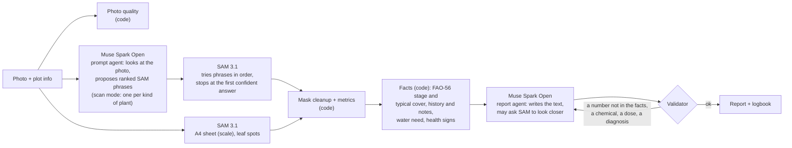

# ElderLeaf

**An old hand for every new grower.**

ElderLeaf turns one phone photo of a plot into measurements a beginner can trust: how many plants there are, how much
of the ground the crop covers, how much of the green is weeds, whether that is normal for the plants' age, and how
much water the plot needs today. It follows the same plot week by week and explains every number in plain language.
**SAM 3.1** draws every plant; **Muse Spark Open** decides what SAM should look for and writes the explanation; code
computes every number, and a validator checks every sentence before the grower reads it.

| Try it | |
|---|---|
| Web app | **https://elderleaf.vercel.app** (no sign-up needed; works as a guest) |
| Android app | [`release/ElderLeaf.apk`](release/ElderLeaf.apk) (side-load; same production API) |
| Three demo scenarios | [`DEMO_SCENARIOS.md`](DEMO_SCENARIOS.md): photos in this repo, plot settings and the results to expect |
| API | FastAPI, deployed on Modal |

Built for the [Meta Global AI Developer Hackathon](https://dev.meta.ai/events/global-hackathon), theme
**Build for Your World**: beginner growers such as community-garden volunteers (for example METU Bostan, the
community garden at our university), new urban gardeners and agriculture students.

---

## For the judges: where each criterion is answered

| Criterion | Where ElderLeaf answers it |
|---|---|
| **Creativity** | An "experienced grower" in your pocket: every number is tied to a SAM mask you can tap; *Is this normal?* compares the plot with the crop's FAO-56 growth stage for its age; water need in litres for *this* plot today; two dates compared with the grower's own notes in between ("…may reflect the weeding you noted on Oct 30"). The text's tone follows the grower's experience. [What it does](#what-it-does) |
| **Technical ambition** | Two Muse Spark agents around SAM 3.1: a **prompt agent** that looks at the photo and chooses open-vocabulary SAM phrases (ranked, with fallbacks; a scan mode for beds with several crops) and a **report agent** that may ask SAM to *look closer*, then writes text that a validator checks against the facts. Measured on **1,010 labelled test images** from two datasets (772 PhenoBench, 238 CropAndWeed), with two Meta LLMs. [Pipeline](#how-metas-models-are-used) · [Evaluation](#evaluation) |
| **Whether it works** | It is live: [web app](https://elderleaf.vercel.app), [APK](release/ElderLeaf.apk) and [three scenarios](DEMO_SCENARIOS.md) you can run in minutes. Accuracy is measured, including what does not work well yet. 43 offline tests run the whole pipeline with fake SAM/LLM clients. |
| **Technical execution** | No language-model output ever becomes a number. Every step is traced live in the app, with a link to everything each SAM call returned. Typed API (FastAPI + Pydantic), costs counted per analysis, answers cached. [Design decisions](#why-this-pipeline-the-decisions-and-the-experiments-behind-them) |
| **Holds up in production** | Deployed on Modal + Supabase (Postgres with row-level security, Storage) + Vercel. Optional accounts (scrypt, hashed session tokens). Every model call has a fallback: no LLM answer → standard words or a template text; an unsure SAM answer → the next phrase. About **$0.013 per photo**. [Production](#architecture-and-production) |

---

## Why

An experienced grower looks at a bed and says "this row is behind". Someone who just started cannot see that, and
cannot tell whether 22% crop cover on day 40 is good or bad. Generic plant apps name a plant or guess a disease; they
do not measure *your* plot, remember it, or tell you what is normal for *its* age. ElderLeaf gives a beginner the
measurement, the history and an answer to "is this normal, and what should I do this week?", while refusing the
things a beginner should not take from an app (diagnoses, pesticide names, doses).

## What it does

| | |
|---|---|
| **Measure from a photo** | Plant count, **crop cover** (canopy: crop pixels only, weeds excluded), weed share, mean plant size (in cm² when an A4 sheet is in the frame), a photo-quality check. Each number has a "How it's computed" line and highlights its masks. |
| **Is this normal?** | The plot's age gives its FAO-56 growth stage; the measured cover is compared with the cover usually seen at that stage and labelled *within typical*, *behind typical* or *many weeds*, with one sentence of context. |
| **Water today** | FAO-56: the day's reference evapotranspiration at the plot (Open-Meteo) × the crop coefficient for the stage, scaled by the crop cover we measured. In L/m² and for the whole plot, with a note when it rained. |
| **Mixed beds** | When the grower says more than one crop grows in the photo, the agent lists every kind of plant it sees and the app counts each crop separately. |
| **Cautious health check** | Possible signs only (yellowing, browning, leaf spots measured inside the crop masks), with a likelihood and a "worth showing to an agronomist" flag set by rules in code. Never a diagnosis, a chemical or a dose. |
| **One report** | The report agent combines everything into one page in the grower's tone (beginner: explains terms; experienced: numbers first), with up to three next steps. |
| **Logbook and Compare** | Every photo and note (watering, fertilizer, spraying, observation) by date, trend charts, CSV export. Two dates side by side: a difference table with per-day rates, the notes written in between, and a change summary written from both photos. |
| **Accounts (optional)** | Use it as a guest, or sign up to keep your plots on any device. A profile holds your garden and growing experience. |
| **Phone** | Installable web app (PWA) and an Android app (Capacitor) with the camera, a "camera with guide" overlay of the last photo, and location for the weather. |

Crops in the library: sugar beet, lettuce, spinach, cabbage, onion, garlic, broad bean, tomato, pepper, wheat, and
*other* (any crop: the agent still names it from the photo).

## How Meta's models are used



- **SAM 3.1** (Meta Model API, $0.0025 per call) draws every mask: one request per concept (crop, weeds, A4 sheet,
  leaf spots, and the report agent's *look closer* phrase).
- **Muse Spark Open** (`meta-models/muse-spark-open-1026`, open weights, on Baseten) is the reasoning model; one
  setting switches to Muse Spark 1.3 on the Meta Model API. It has two jobs:
  1. **Prompt agent** ([`agent.py`](api/elderleaf/agent.py)): looks at the photo and proposes three ranked SAM phrases
     for the crop and for the weeds (e.g. "lettuce seedling", "grass weed"). The pipeline tries them in order and falls
     back to fixed words when SAM is unsure. For a bed with **more than one crop** it switches to **scan mode**: one
     phrase per kind of plant it sees, each tagged with its crop or as a weed; SAM searches them all.
  2. **Report agent** ([`report_agent.py`](api/elderleaf/report_agent.py)): reads the facts computed in code, may ask
     SAM 3.1 to look closer once at a possible problem it sees, and writes 2–3 plain sentences, a line for each
     *Is this normal?* check and up to three next steps. It also writes the change summary of **Compare** from both
     photos.
- **The validator** checks every sentence before the grower sees it: each number must appear in the facts
  (measurements, history, crop library, weather), and there must be no chemical or product names, no doses and no
  disease or pest names. A failed text goes back once with the reasons; if it fails again the grower gets a template
  text. The app shows what the validator caught.
- **No LLM output becomes a number.** Counts, percentages, sizes, water need and the consult flag are computed in code
  ([`metrics.py`](api/elderleaf/metrics.py), [`health.py`](api/elderleaf/health.py),
  [`irrigation.py`](api/elderleaf/irrigation.py), [`pipeline.py`](api/elderleaf/pipeline.py)).

Every step is written to the analysis trace as it happens, so the app shows the agents working live, newest step
first.

## Why this pipeline: the decisions and the experiments behind them

Each choice below was made after a measurement, not before. The full numbers are in [Evaluation](#evaluation).

1. **The crop must be named; the grower tells us the crop.** The generic phrase `crop plant` returned **no masks at
   all** on 772 PhenoBench photos, while `sugar beet plant` reached crop cover within **0.8 points** of the hand
   labels. So the app asks for the crop instead of guessing it.
2. **An agent chooses SAM's words, because a fixed word per crop does not generalise.** On CropAndWeed (8 crops),
   the crop's plain name found almost nothing for several crops; the agent's phrases from the photo raised crop F1
   for maize **0.07 → 0.51**, sunflower **0.00 → 0.49**, soybean **0.00 → 0.46**, pumpkin **0.00 → 0.38** and potato
   **0.12 → 0.46** (all crops: **0.35 → 0.48**). Phrases are ranked and SAM stops at the first confident answer, so
   an easy photo costs fewer calls; if the agent fails, fixed words take over.
3. **Scan mode only when the grower says the bed is mixed.** On real photos with two crops, searching each crop's
   name found almost nothing (crop F1 **0.04**); scan mode reached **0.78**. On single-crop PhenoBench, scan mode was
   worse than the ranked agent (crop F1 0.55 vs 0.60, cover error 4.3 vs 1.1 points). So it is opt-in, and it gets
   fallbacks (a crop's library word, then "weed", then "plant").
4. **When a plant is found as crop and as weed, the crop wins.** The grower told us what they planted. On the full
   PhenoBench run this cut the agent's count error from **6.25 to 3.80** plants per photo and its crop-cover error
   from **3.1 to 1.1** points. A second rule drops weed masks that lie mostly on crop plants: on a lettuce photo a
   weed phrase ("grassy weed blade") found 11 single lettuce leaves, each 95–100% inside a lettuce mask but too small
   for the overlap (IoU) rule to catch.
5. **Muse Spark Open, not a bigger model.** We ran Muse Wonder 1.0 on the same photos. Crop F1 stayed within 0.04 of
   Muse Spark Open and weed F1 was a little higher, at **2–3.7× the cost per photo**. Spark Open is the better trade for a
   free app.
6. **Numbers in code, words by the model, a validator in between.** A beginner may trust the app blindly, so the
   model may only explain numbers it was given, and it may never name a chemical, a dose or a disease.
7. **A cautious health check, calibrated on healthy plants.** Yellowing measured with a fixed hue marked 28–53% of the
   crop area as yellow on healthy sugar beets, so it is measured against the photo's own crop color instead. The SAM leaf-spot search
   found no spots on 8 healthy PhenoBench photos before it was switched on by default. The consult flag is a rule in
   code (poor photo, spots ≥ 5% of the crop, discoloration medium or more, or low confidence).
8. **Published agronomy, labelled honestly.** Growth stages and crop coefficients come from FAO Irrigation and
   Drainage Paper 56; the expected-cover band per stage is our own rule of thumb and is labelled as such.
9. **Cheap to run.** SAM and LLM answers are cached; a Compare summary written by the agent is stored, so opening the
   same pair again costs nothing. A typical analysis costs about **$0.013**.

## Evaluation

Scripts and method: [`eval/README.md`](eval/README.md). Full tables:
[`eval/results/full/summary.md`](eval/results/full/summary.md) (SAM 3.1 per phrase) and
[`eval/results/mixed/report.md`](eval/results/mixed/report.md) (systems, mixed beds, models). Masks are matched one to
one at IoU ≥ 0.5 with SAM's confidence threshold 0.5, using the app's final masks (after cleanup and the conflict
rules). The full PhenoBench run alone took 4,632 SAM requests.

**PhenoBench** (validation split: 772 photos, sugar beet and weeds, three growth stages)

| System (what SAM is asked) | Count error / photo | Crop cover error | Crop F1 | Weed F1 | Cost / photo | Wait* |
|---|---|---|---|---|---|---|
| fixed `crop plant` | 8.4 (finds nothing) | 9.6 pts | 0.00 | – | $0.005 | 12 s |
| fixed `plant` (cannot tell crop from weed) | 2.7 | 1.1 pts | 0.63 | 0.01 | $0.005 | 12 s |
| fixed crop name `sugar beet plant` | 3.9 | **0.8 pts** | 0.61 | 0.23 | $0.005 | 12 s |
| **Muse Spark Open prompt agent** | 3.8 | 1.1 pts | 0.60 | **0.25** | $0.013 | 52 s |
| agent, scan mode | 4.5 | 4.3 pts | 0.55 | 0.25 | $0.010 | 25 s |

\*measured with many photos running in parallel, so the wait is pessimistic.

**CropAndWeed**: 8 crops (maize, sugar beet, sunflower, soybean, pumpkin, bean, pea, potato), mostly with three or
more weed species. Images are not in this repo (licence).

| Set | System | Crop F1 | Right-crop F1 | Weed F1 | Count error | Cost / photo |
|---|---|---|---|---|---|---|
| A: one crop per photo (160) | fixed `plant` | 0.41 | – | 0.01 | 10.1 | $0.005 |
| | fixed crop name | 0.35 | 0.35 | **0.40** | **4.2** | $0.005 |
| | **prompt agent** | **0.48** | **0.48** | 0.13 | 7.0 | $0.012 |
| B-real: two crops in one photo (38) | fixed crop names | 0.04 | 0.04 | 0.10 | 10.9 | $0.008 |
| | fixed `plant` | 0.80 | – | 0.03 | 3.1 | $0.005 |
| | **agent, scan mode** | **0.78** | **0.46** | 0.04 | 3.1 | $0.010 |
| B-collage: two crops side by side (40) | fixed crop names | 0.57 | 0.30 | 0.42 | 3.3 | $0.008 |
| | agent, scan mode | 0.54 | 0.31 | 0.07 | 8.1 | $0.011 |

*Right-crop F1* also requires the right crop name (a plain `plant` search cannot tell crops apart).

**Muse Spark Open vs Muse Wonder 1.0** (same photos, same pipeline)

| Set | Spark Open crop / weed F1 | Wonder 1.0 crop / weed F1 | Cost / photo, Spark Open → Wonder |
|---|---|---|---|
| PhenoBench, 100 photos (prompt agent) | 0.57 / 0.26 | 0.57 / 0.28 | $0.013 → $0.026 |
| CropAndWeed A, 160 photos (prompt agent) | 0.48 / 0.13 | 0.47 / 0.14 | $0.012 → $0.025 |
| CropAndWeed B-real, 38 photos (scan mode) | 0.78 / 0.04 | 0.82 / 0.07 | $0.010 → $0.036 |

**What does not work well yet**

- **Counts run low when plants touch.** Recall is 0.34–0.39 for plants touching two or more others, because touching
  plants merge into one mask; seedlings under ~200 pixels are mostly missed. Crop cover is much more reliable than
  the count.
- **Weeds are the hardest part** (weed F1 0.13–0.40). On CropAndWeed, the plain word "weed" found more weeds than
  the agent's descriptive phrases (0.40 vs 0.13), so weed share is shown as a rough guide. Next step: always run a
  plain "weed" pass alongside the agent's phrases.
- **Telling two crops apart** in one photo is harder than finding plants (right-crop F1 0.46 on B-real).
- The weed-on-crop rule from decision 4 came from a real lettuce photo and has not been re-scored on the datasets yet.
- No field numbers from our own garden yet: every figure above is from public datasets.

## Architecture and production

```
Phone / browser ──► Vercel (Next.js 16 web app, PWA)          Android app (Capacitor, same pages)
                         │                                              │
                         └────────────── HTTPS ─────────────────────────┘
                                          ▼
                   Modal: FastAPI + analysis threads (one always-on container,
                   SAM/LLM answer cache on a Modal Volume)
                      │                    │                        │
          Meta Model API (SAM 3.1)   Baseten (Muse Spark Open)   Open-Meteo (weather)
                      │
          Supabase: Postgres (plots, analyses, notes, users; row-level security) + Storage (photos)
```

- **Uploads return at once**; the analysis runs in the background and the browser polls the live trace.
- **Fallbacks everywhere:** LLM unreachable → standard SAM words and template texts; SAM unsure → the next phrase;
  weather unavailable → the water card says why.
- **Accounts are optional:** a guest's plots belong to a random device id; signing up moves them into the account.
  Passwords are hashed with scrypt; only the SHA-256 of each session token is stored. Row-level security keeps
  Supabase's public REST API away from the tables.
- **Tests:** `cd api && uv run pytest -q` runs 43 offline tests (fake SAM and LLM): the whole pipeline, the
  validator, the report agent, Compare, mixed beds, accounts.

## Try it

ElderLeaf is live, so there is nothing to install or run locally. The API is deployed on Modal,
and both apps use it:

- **Web:** open **https://elderleaf.vercel.app** in any browser, on a phone or a laptop. You start as a guest; no
  sign-up is needed.
- **Android:** download [`release/ElderLeaf.apk`](release/ElderLeaf.apk) and install it (allow installs from unknown
  sources; the APK is debug-signed).

[`DEMO_SCENARIOS.md`](DEMO_SCENARIOS.md) gives three photos with the plot settings and the results to expect.

## Repository

```
api/        FastAPI backend: SAM 3.1 client, mask cleanup, metrics, prompt agent, report agent, validator,
            FAO-56 crop library and water need, Compare
web/        Next.js app (PWA + Android via Capacitor): My plots · plot logbook and Compare · analysis
eval/       Evaluation scripts and stored results (datasets are downloaded by the scripts, never committed)
demo/       The three photos used in DEMO_SCENARIOS.md
release/    ElderLeaf.apk, built against the production API
docs/       Work plan
```

## Built during the hackathon

Everything in this repository was written during the hackathon building period (27 October – 4 November 2026): the
API, the agents, the evaluation scripts and results, the web app and the Android app.

## Data and credits

- **PhenoBench**: Weyler et al., *PhenoBench: A Large Dataset and Benchmarks for Semantic Image Interpretation in the
  Agricultural Domain*, IEEE TPAMI 2024 ([phenobench.org](https://www.phenobench.org)). The website says CC BY-SA 4.0
  and the README in the archive says CC BY-NC-SA 4.0; we follow the stricter terms. Used for evaluation; the three
  unmodified photos in [`demo/`](demo) are shared for non-commercial demonstration with this attribution.
- **CropAndWeed**: Steininger et al., *The CropAndWeed Dataset: a Multi-Modal Learning Approach for Efficient Crop and
  Weed Manipulation*, WACV 2023. Non-commercial evaluation only; its images are not redistributed.
- **FAO Irrigation and Drainage Paper 56** (Allen et al., 1998): crop coefficients, stage lengths, the cover adjustment
  (eq. 97–98). Values in [`crop_library.json`](api/elderleaf/crop_library.json) are approximate.
- **Open-Meteo**: daily FAO-56 reference evapotranspiration for the plot's location.
- **Meta**: SAM 3.1, Muse Spark Open, Muse Spark 1.3 and Muse Wonder 1.0 (evaluation).

## License

MIT, see [LICENSE](LICENSE).
